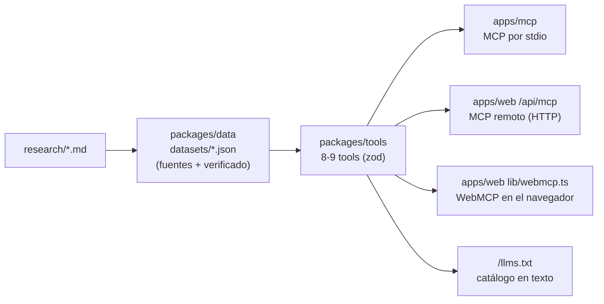

# WebMCP en Forja NL

Explicación técnica de cómo el sitio de Forja NL expone sus herramientas a agentes de IA y guion para contarlo en el pitch.

> Estado al 14 de octubre de 2026. El código citado (`archivo:línea`) corresponde a ese día. `apps/web/app/page.tsx`, `packages/tools/src/catalogo.ts` y `packages/data/` se siguen editando, así que algunas líneas y conteos pueden moverse.
>
> **Producción vs. local:**
> - **Producción** (https://forja-nl.vercel.app): **8 tools** y 9 datasets.
> - **Repo local** (sin commitear): **9 tools**. Se suma `forja_panorama_ia_nl`, `forja_buscar_programas` gana los catálogos `hallazgos` y `panorama`, y hay 11 datasets. Al desplegar, las tres superficies tomarán las 9 tools solas.

---

## 1. Qué es WebMCP

Hoy, cuando un agente de IA (por ejemplo, el asistente integrado en el navegador) quiere usar una página web, tiene que hacer lo mismo que una persona: mirar la pantalla, leer el HTML, adivinar qué botón apretar y llenar formularios. Es lento, falla en cuanto cambia el diseño y el agente nunca sabe si entendió bien. **WebMCP** propone algo más directo: que la página le diga al navegador "estas son las cosas que sé hacer, con estos parámetros", y el agente las llame como funciones.

En la práctica, la página registra **tools** (herramientas) con JavaScript: cada tool tiene un nombre, una descripción en lenguaje natural, un esquema de sus parámetros (JSON Schema) y una función que hace el trabajo. El navegador junta esas tools y se las ofrece a su agente. El W3C lo describe como convertir la página en un "servidor MCP dentro de la página": usa el vocabulario del Model Context Protocol (MCP), pero corre en el navegador, con el modelo de seguridad de la web (origen, HTTPS, permisos) y sin servidor de por medio.

La diferencia con un servidor MCP tradicional es que el usuario y el agente trabajan **en la misma pestaña**, con el mismo estado: la persona ve lo que el agente hace. Es un borrador del *Web Machine Learning Community Group* del W3C (editores de Microsoft y Google). Todavía no es estándar: en Chrome está detrás de una flag o de un *origin trial*.

```
 ┌───────────────────────── pestaña de Chrome ─────────────────────────┐
 │                                                                     │
 │  forja-nl.vercel.app                                                │
 │  ┌───────────────────────────┐   1. registerTool(tool)              │
 │  │ WebMcpProvider (React)    │ ───────────────────────┐             │
 │  │ lib/webmcp.ts             │                        ▼             │
 │  └───────────────────────────┘            ┌──────────────────────┐  │
 │        ▲            │                     │ document.modelContext│  │
 │        │            │ 4. tool.handler()   │ (API del navegador)  │  │
 │        │            ▼                     └──────────────────────┘  │
 │        │   ┌──────────────────────┐        2. getTools() │  ▲        │
 │        │   │ @forja/tools         │                      ▼  │ 3. executeTool(tool, args)
 │        │   │ simulador + catálogo │            ┌──────────────────┐ │
 │        │   └──────────────────────┘            │ Agente del       │ │
 │        │            │                          │ navegador        │ │
 │        │            ▼                          └──────────────────┘ │
 │        │   ┌──────────────────────┐                                 │
 │        └── │ @forja/data (JSON    │  5. resultado JSON con fuentes  │
 │            │ con fuentes)         │     ───────────▶ agente         │
 │            └──────────────────────┘                                 │
 └─────────────────────────────────────────────────────────────────────┘
   Todo pasa dentro del navegador: los datasets viajan en el bundle JS,
   así que ejecutar una tool no hace ninguna petición de red.
```

---

## 2. MCP vs WebMCP en Forja NL

**MCP** (Model Context Protocol) es el protocolo con el que un agente como Claude Code, Cursor o Grok se conecta a un servidor de herramientas. **WebMCP** es su versión dentro del navegador. En Forja NL las tools se definen **una sola vez** en `packages/tools/src/catalogo.ts` (el arreglo `tools` en `packages/tools/src/index.ts:8`) y se publican en tres superficies:



| Superficie | Quién la usa | Transporte | Cómo conectarse | Código |
| --- | --- | --- | --- | --- |
| **MCP local** | El equipo, en su máquina (Claude Code, Claude Desktop) | stdio (JSON-RPC por entrada/salida estándar) | `npm run mcp`, o `claude mcp add forja-local -- npx tsx "$PWD/apps/mcp/src/index.ts"` desde la raíz del repo | `apps/mcp/src/index.ts:7-19` |
| **MCP remoto** | Cualquier cliente MCP en internet: Claude Code, Cursor, Claude Desktop, Codex, etc. | Streamable HTTP, sin autenticación | `claude mcp add --transport http forja-nl https://forja-nl.vercel.app/api/mcp` | `apps/web/app/api/[transport]/route.ts:7-40` |
| **WebMCP** | El agente integrado en el navegador (Chrome/Edge con la flag o el origin trial) | Ninguno: llamada JavaScript dentro de la pestaña | Abrir https://forja-nl.vercel.app en un navegador compatible | `apps/web/lib/webmcp.ts`, `apps/web/components/WebMcp.tsx` |
| *(extra)* **llms.txt** | Modelos que leen la web | HTTP GET, texto plano | https://forja-nl.vercel.app/llms.txt | `apps/web/app/llms.txt/route.ts:8-54` |

Lo que conviene contar: **agregar una tool es editar un solo archivo**. Las tres superficies leen el mismo arreglo, así que no hay que registrarla a mano en ninguna app (es una regla de `AGENTS.md`).

---

## 3. Cómo funciona en nuestro código

### 3.1 La definición común: `ForjaTool`

- `packages/tools/src/types.ts:9-15`: cada tool tiene `name` (snake_case, prefijo `forja_`), `title`, `description` (escrita para el modelo: qué hace y cuándo usarla), `inputSchema` (un *shape* de **zod**) y `handler` (función que devuelve JSON).
- `packages/tools/src/catalogo.ts:83-431`: el catálogo. En producción son 8 tools; en el repo local hay una novena, `forja_panorama_ia_nl`, que empieza en la línea 363.
- `packages/tools/src/simulador.ts:98-139`: `simularFondo()`, la fórmula del fondo. La usan la tool `forja_simular_fondo` y también el simulador visual de la página (`apps/web/components/Simulador.tsx:4,77`). La cifra que ve la persona y la que recibe el agente salen del mismo código.
- Los datos vienen de `packages/data/src/index.ts:16-29` (`datasets`, `getDataset`). Cada dataset tiene `fuentes` y `verificado` (`packages/data/src/types.ts:9-18`).

### 3.2 Montaje en la página

- `apps/web/app/layout.tsx:43`: `<WebMcpProvider />` se monta en el layout raíz. Las tools se registran en cuanto carga el sitio, sin depender de que el usuario llegue a la sección "Agentes".
- `apps/web/components/WebMcp.tsx:7-23`: un `useEffect` llama a `registerWebMcp()` (solo en el cliente, nunca en el servidor). Si el primer intento da "no soportado", **reintenta a los 1.5 s** (líneas 11-16), porque algunos polyfills o extensiones inyectan `modelContext` tarde. Al desmontar, limpia (líneas 17-20).

### 3.3 Detección de la API

- `apps/web/lib/webmcp.ts:58-66` (`findProvider`): busca un objeto con `registerTool` o `provideContext` en `navigator.modelContext` y luego en `document.modelContext`.
- Así cubrimos las dos generaciones de la API (comentario en `webmcp.ts:1-5`). El *early preview* y el explainer original usaban `navigator.modelContext` con `provideContext({ tools })`. El borrador actual del W3C y Chrome usan `document.modelContext.registerTool()`.
- **Verificado por el equipo:** en Google Chrome 155, lanzado con `--enable-features=WebMCPTesting,DevToolsWebMCPSupport`, la API está en `document.modelContext`.
- Si no encuentra ninguno, el estado pasa a `unsupported` (`webmcp.ts:91-95`) y la página sigue funcionando igual.

### 3.4 Conversión zod → JSON Schema

- `packages/tools/src/index.ts:11`: `toJsonSchema(tool)` usa `z.toJSONSchema(z.object(tool.inputSchema))`. Los navegadores no entienden zod; necesitan JSON Schema estándar (draft 2020-12).
- `apps/web/lib/webmcp.ts:68-87` (`toWebMcpTool`): convierte cada `ForjaTool` al diccionario que pide el navegador:
  - `name`, `title`, `description`;
  - `inputSchema: toJsonSchema(tool)` (línea 73);
  - `annotations: { readOnlyHint: true }` (línea 74): le dice al agente que la tool **no modifica nada**;
  - `execute` (líneas 75-85).
- El mismo `toJsonSchema` alimenta `/llms.txt` (`apps/web/app/llms.txt/route.ts:9-14`) y la lista de tools que se ve en la página (`apps/web/app/page.tsx:40-58`, `toolResumen`).

### 3.5 Registro

- `apps/web/lib/webmcp.ts:97-112`: crea un `AbortController` y llama `provider.registerTool(def, { signal })` por cada tool. Si una falla, la registra en consola y sigue con las demás. Al final, estado `registered` con la lista de nombres.
- `webmcp.ts:113-116`: si el navegador solo tiene la API vieja, usa `provideContext({ tools: defs })`.
- **Verificado por el equipo:** en Chrome 155 con la flag, la página registró todas sus tools.

### 3.6 Ejecución y formato de respuesta

- Cuando el agente llama `document.modelContext.executeTool(tool, args)`, el navegador ejecuta nuestro `execute(input)` (`webmcp.ts:75-85`). Este llama a `tool.handler(input)` y devuelve el formato de MCP:
  ```json
  { "content": [{ "type": "text", "text": "{\"alumnos_beneficiados\":23847, ...}" }] }
  ```
- Si el handler lanza un error, devuelve `{ content: [{ type: "text", text: "Error: ..." }], isError: true }` (líneas 79-83). Así el agente lee el mensaje y puede corregir sus parámetros.
- Según el borrador del W3C, el navegador convierte ese objeto a JSON y `executeTool` resuelve con un **string**. Por eso, en consola hay que hacer `JSON.parse` (ver sección 5).
- Para comparar: el MCP local usa `ejecutarTool` (`packages/tools/src/index.ts:14-27`), que valida los argumentos con zod y además devuelve `structuredContent`. El MCP remoto (`route.ts:18-27`) devuelve texto más `structuredContent`.

### 3.7 Des-registro al desmontar

- `apps/web/lib/webmcp.ts:121-141`: la función de limpieza hace `controller.abort()` (línea 122), que es la forma oficial de quitar tools en el borrador actual. También llama `unregisterTool(name)` si existe (API vieja) o `clearContext()` / `provideContext({ tools: [] })`.
- Esto evita tools duplicadas con React Strict Mode o con recargas en caliente durante el desarrollo.

### 3.8 UI de estado

- `apps/web/lib/webmcp.ts:38-56`: el estado vive en un pequeño *store* (`checking` → `registered` | `unsupported` | `error`).
- `apps/web/components/WebMcp.tsx:25-66` (`WebMcpStatusBadge`) lo lee con `useSyncExternalStore`. En el servidor siempre es `checking` (`webmcp.ts:48`), así se evitan errores de hidratación.
  - **registered**: punto verde pulsante y el texto "WebMCP detectado: N tools registradas en esta pestaña" (8 en producción hoy).
  - **checking**: "Detectando WebMCP…".
  - **unsupported**: "WebMCP no disponible en este navegador", con la explicación de cómo activarlo.
  - **error**: el mensaje de error.
- `apps/web/components/Agentes.tsx:92-108`: el panel "WebMCP · el sitio es una API para agentes" muestra el badge (línea 99) y enlaza a `/llms.txt`. Al lado, `Agentes.tsx:41-57` muestra los comandos para conectar el MCP remoto (Claude Code, Cursor/Claude Desktop y `mcp-remote` para clientes que solo hablan stdio). `Agentes.tsx:111-146` lista las tools en vivo.
- **Verificado por el equipo:** sin la flag, la página muestra "WebMCP no disponible" y todo lo demás funciona normal.

---

## 4. Catálogo de tools

Todas las tools son de solo lectura (`readOnlyHint: true`).
- **Producción:** 8 tools, según `tools/list` del MCP remoto.
- **Repo local:** 9 tools, según `tools/list` del MCP local (`npx tsx apps/mcp/src/index.ts`). La novena, marcada *(local)* en la tabla, aparece en producción en el siguiente deploy.

### Resumen

| Tool | Qué hace | Parámetros (todos opcionales salvo que diga *requerido*) | ¿Devuelve datos con `verificado: false`? |
| --- | --- | --- | --- |
| `forja_info` | Explica qué es Forja NL, cómo funciona, qué datasets hay y una simulación base. En local también trae `por_que_lo_financia_nuevo_leon` (solo hallazgos verificados) | ninguno | Sí: lista todos los datasets con su bandera |
| `forja_listar_datasets` | Lista los datasets con descripción, número de registros, fuentes y verificación | ninguno | Sí: matrícula, ecosistema de startups, programas de emprendimiento, educación en IA y, en local, `panorama-ia-nl` |
| `forja_consultar_dataset` | Devuelve los registros de un dataset, con filtro de texto | `id` (*requerido*, enum con los ids de los datasets: 9 en producción, 11 en local), `buscar` (texto, sin importar acentos), `limite` (entero 1-200, por defecto 50) | Depende del `id`. Además, cada registro puede traer su propio `verificado` |
| `forja_simular_fondo` | Calcula cuántos alumnos financia un presupuesto, el costo por alumno al mes y los tokens totales | `presupuesto_mxn` (≥ 0, MXN, por defecto 50,000,000), `meses` (entero > 0, por defecto 6), `tokens_por_alumno_mes` (> 0, por defecto 20,000,000), `modelo_id` (por defecto `"mezcla-forja"` = 70% Grok 4.3 + 30% Grok 4.7), `proporcion_input` (0-1, por defecto 0.8) | No: precios y tipo de cambio están verificados (`verificado: true`). **Pero** los 20 M tokens/alumno/mes y la mezcla 70/30 son supuestos de Forja, no datos |
| `forja_comparar_modelos` | Compara el costo de N tokens en los 12 modelos del dataset de precios, en USD y MXN, del más barato al más caro | `tokens` (> 0, por defecto 1,000,000), `proporcion_input` (0-1, por defecto 0.8), `proveedor` (ej. `"xAI"`), `categoria` (`frontera` / `economico` / `abierto`) | No (`verificado: true`). Son precios de lista sin descuentos |
| `forja_listar_cursos` | Devuelve la ruta de formación (módulos, horas, modalidad, temas) | `nivel` (`fundamentos` / `construccion` / `lanzamiento`) | No, pero la fuente es "Propuesta Forja NL": es nuestro diseño, no un dato externo |
| `forja_impacto_municipio` | Reparte a los beneficiarios por municipio según la población de 15 a 29 años y calcula el % de jóvenes y universitarios cubiertos | los 5 del simulador + `municipio` (texto, sin importar acentos) | Sí: la matrícula universitaria es `false`. El desglose por municipio todavía no existe y devuelve `[]` con una nota |
| `forja_buscar_programas` | Busca en varios catálogos a la vez: apoyos a emprendedores en NL/MX, educación en IA en NL y programas de laboratorios de IA que dan créditos. En local suma `hallazgos` (por qué el fondo lo financia NL) y `panorama` | `catalogo` (`todos` / `emprendimiento` / `educacion-ia` / `laboratorios`, y en local también `hallazgos` / `panorama`; por defecto `todos`), `texto`, `laboratorio`, `tipo`, `solo_verificados` (booleano), `limite` (entero 1-100, por defecto 30) | Sí: `emprendimiento`, `educacion-ia` y `panorama` son `false`. `laboratorios` y `hallazgos` son `true` (un hallazgo no lo está) |
| `forja_panorama_ia_nl` *(local)* | Inventario de iniciativas de IA y digitalización en NL (gobierno, Poder Judicial, Congreso, municipios, salud, universidades, empresas) con estado, evidencia de IA, cifra citable y fuente. Incluye resumen por sector y `cifras_verificadas_para_pitch` | `sector` (enum de 10), `ia` (`explícita` / `no confirmada` / `no es IA`), `estado` (texto), `texto`, `solo_verificados`, `solo_cifras` (booleanos), `limite` (entero 1-200, por defecto 60) | Sí: el dataset es `false` (28 de 51 registros verificados). Usa `cifras_verificadas_para_pitch` o `solo_verificados: true` |

Todas las respuestas incluyen `fuentes`, y varias un `aviso`: "Si verificado es false (en el dataset o en un registro), preséntalo como estimado o déjalo fuera del pitch" (`catalogo.ts:22-23`).

### Ejemplos (respuestas reales del 14 de octubre de 2026, resumidas)

**`forja_simular_fondo`**: la tool estrella del demo.

```json
// llamada
{ "presupuesto_mxn": 100000000 }
// respuesta (resumida)
{
  "alumnos_beneficiados": 23847,
  "costo_por_alumno_mes_mxn": 698.88,
  "costo_por_alumno_mes_usd": 37.8,
  "tokens_totales": 2861640000000,
  "modelo": { "id": "mezcla-forja", "nombre": "Mezcla Forja (70% Grok 4.3 + 30% Grok 4.7)", "usd_por_millon_tokens": 1.89 },
  "tipo_cambio_mxn_usd": 18.4888,
  "presupuesto_sobrante_mxn": 3332.6,
  "supuestos": ["Cada alumno usa 20 millones de tokens al mes…", "80% entrada / 20% salida", "…precio de lista sin descuentos…", "Tipo de cambio FIX de Banxico del 2026-10-14…", "El 100% del presupuesto se va a tokens…"],
  "fuentes": ["xAI", "Anthropic", "OpenAI", "Google", "Groq", "DeepSeek", "Banxico CF373"],
  "verificado": true
}
```

- **Verificado por el equipo:** este mismo resultado (23,847 alumnos a 698.88 MXN por alumno al mes) salió vía `document.modelContext.executeTool` en Chrome 155. También coincide con el MCP local y con el MCP remoto en producción.
- Sin parámetros, el escenario base es 50 M MXN en 6 meses: 11,923 alumnos.
- La fórmula está en `simulador.ts:109-111`: `alumnos = floor(presupuesto / (costo_mensual_por_alumno × meses))`.

**`forja_comparar_modelos`**

```json
{ "tokens": 20000000 }
// → 12 modelos ordenados. Costo en MXN de 20 M tokens (80/20) con TC 18.4888:
//   Claude Haiku 5.5 y GPT-6 Luna: 66.56 · GPT OSS 120B (Groq): 88.75 · Grok Build 0.1: 443.73
//   Grok 4.3: 554.66 · Grok 4.7: 1,035.37 · Claude Opus 5.5: 2,662.39 (el más caro)
//   También devuelve "millones_de_tokens_por_1000_mxn" por modelo. verificado: true
```

**`forja_impacto_municipio`**

```json
{ "municipio": "Monterrey" }
// → beneficiarios_totales: 11923
//   estado: { poblacion_15_29: 1464071, anio: 2020, porcentaje_jovenes_cubiertos: 0.81 }
//   educacion_superior: { matricula: 324299, porcentaje_universitarios_cubiertos: 3.68, verificado: false }
//   municipios: []   ← notas: "Pendiente de research: aún no hay desglose por municipio…"
```

**`forja_buscar_programas`**

```json
{ "catalogo": "laboratorios", "laboratorio": "xAI" }
// → 1 resultado: "Grok for Startups", créditos de API de Grok evaluados caso por caso, sin monto publicado,
//   no transferibles; vía de contacto: startups@x.ai. verificado: true
```

**`forja_consultar_dataset`**

```json
{ "id": "ecosistema-startups-nl", "limite": 3 }
// → verificado: false (a nivel dataset). Registros, cada uno con su propio verificado, por ejemplo:
//   "Lugar global de Monterrey en StartupBlink": 198 (2026, verificado: true, visto en prensa que cita StartupBlink)
//   "Startups tech fundadas en Monterrey en 2025": 8 (verificado: false)
```

**`forja_listar_cursos`**

```json
{}
// → 6 cursos, 58 horas en total. Módulo 1: "IA responsable y uso seguro de tokens" (6 h, en línea),
//   requisito_para_creditos: true. Fuente: "Propuesta Forja NL".
```

**`forja_panorama_ia_nl`** *(local)*

```json
{ "sector": "municipio", "limite": 2 }
// → resumen: { total: 51, verificados: 28, ia_explicita: 36, por_sector: { municipio: { total: 8, verificados: 4 }, … } }
//   cifras_verificadas_para_pitch (7), por ejemplo:
//     "Adopción de IA en empresas de Nuevo León": 12.6% (primer lugar nacional; promedio 8.0%), Gobierno de NL, 12/03/2026
//     "Capacitación en IA a docentes de educación básica": ~50,000 docentes, Gobierno de NL, 08/10/2026
//   registros: "C4/ESCUDO Monterrey", más de 7,500 cámaras, ia: "no confirmada"
//              (nota: "Prueba infraestructura de seguridad, no IA."), verificado: true
```

**`forja_info`** y **`forja_listar_datasets`** no reciben parámetros. Devuelven la propuesta, la narrativa ("El acero del siglo XXI son los tokens"), los datasets con su estado de verificación y, en el caso de `forja_info`, la simulación base.

---

## 5. Cómo probarlo

### 5.1 WebMCP en Chrome

1. **Cierra Chrome por completo** (Cmd+Q). Si ya hay una instancia abierta con el mismo perfil, la flag se ignora. Luego:
   ```bash
   open -na "Google Chrome" --args --enable-features=WebMCPTesting,DevToolsWebMCPSupport https://forja-nl.vercel.app
   ```
   Para no cerrar tu Chrome de trabajo, usa un perfil aparte:
   ```bash
   open -na "Google Chrome" --args --user-data-dir=/tmp/chrome-webmcp --enable-features=WebMCPTesting,DevToolsWebMCPSupport https://forja-nl.vercel.app
   ```
   La alternativa manual es `chrome://flags/#enable-webmcp-testing` → *Enabled* → reiniciar.
2. Baja a la sección **Agentes**. El badge debe decir "WebMCP detectado: 8 tools registradas en esta pestaña" (9 después del siguiente deploy).
3. Abre DevTools → Console y pega:
   ```js
   const mc = document.modelContext ?? navigator.modelContext;
   const tools = await mc.getTools();
   console.table(tools.map((t) => ({ name: t.name, title: t.title })));

   const sim = tools.find((t) => t.name === "forja_simular_fondo");
   const args = { presupuesto_mxn: 100_000_000 };
   let out;
   try {
     out = await mc.executeTool(sim, args);
   } catch {
     out = await mc.executeTool(sim, JSON.stringify(args)); // algunas builds esperan los args como texto JSON
   }
   const r = typeof out === "string" ? JSON.parse(out) : out;
   const datos = r?.content?.[0]?.text ? JSON.parse(r.content[0].text) : r;
   console.log(datos.alumnos_beneficiados, "alumnos ·", datos.costo_por_alumno_mes_mxn, "MXN/alumno/mes");
   // → 23847 alumnos · 698.88 MXN/alumno/mes
   ```
4. **Contraprueba:** abre el sitio en un Chrome normal (sin la flag). El badge dice "WebMCP no disponible en este navegador" y el resto del sitio funciona igual.

### 5.2 MCP remoto en Claude Code

Sintaxis verificada con `claude mcp add --help`: `claude mcp add [options] <name> <commandOrUrl>`, con `-t, --transport <stdio|sse|http>`.

```bash
claude mcp add --transport http forja-nl https://forja-nl.vercel.app/api/mcp
claude mcp list          # debe aparecer forja-nl
```

- Después, en Claude Code: *"Con las tools de forja-nl, ¿a cuántos alumnos alcanza un fondo de 100 millones de pesos?"*.
- Usamos el nombre `forja-nl`, igual que el sitio y `/llms.txt`; el nombre es libre. Agrega `-s user` para tenerlo en todos tus proyectos.

Prueba sin cliente (verificada en producción: responde `tools/list` con las 8 tools):

```bash
curl -s -X POST https://forja-nl.vercel.app/api/mcp \
  -H 'content-type: application/json' -H 'accept: application/json, text/event-stream' \
  -d '{"jsonrpc":"2.0","id":1,"method":"tools/list"}'
```

### 5.3 MCP local (stdio)

```bash
npm run mcp     # en stderr: "[forja-nl] MCP por stdio listo con 9 tools" (el repo local de hoy)
```

---

## 6. Guion de demo para el pitch (30-45 s)

**Preparación:** laptop propia con Chrome abierto con la flag (sección 5.1), la pestaña en la sección **Agentes** y la consola con el snippet ya pegado (sin ejecutar). Como respaldo, ten Claude Code con `forja-nl` conectado y un video corto grabado del demo.

| Tiempo | Qué mostrar | Qué decir |
| --- | --- | --- |
| 0-10 s | La sección Agentes con el badge verde "N tools registradas" | "Forja NL no es solo una página para personas. También es una API para agentes. Con WebMCP, el nuevo estándar del W3C que impulsan Google y Microsoft, la página le entrega al navegador sus herramientas: simular el fondo, comparar modelos, buscar programas." |
| 10-25 s | Enter en la consola (o pedirle al agente del navegador "simula un fondo de 100 millones") → `23847 alumnos · 698.88 MXN/alumno/mes` | "Un agente pregunta: ¿a cuántos jóvenes alcanza un fondo de 100 millones de pesos? Sin scraping y sin servidor: la página responde 23,847 alumnos a unos 700 pesos al mes cada uno, con precios oficiales de las APIs y el tipo de cambio FIX de Banxico de hoy." |
| 25-40 s | La lista de tools y el comando `claude mcp add …` en pantalla | "Es la misma definición que exponemos como servidor MCP en internet. Cualquier funcionario, universidad o startup puede conectar Claude, Grok o Cursor y consultar nuestras cifras, cada una con su fuente. Si un dato no está verificado, la tool misma lo dice." |
| (cierre) | — | "En el siglo XX Nuevo León forjó acero. Hoy, hasta su sitio web habla con la inteligencia artificial." |

Ojo con el discurso:
- Di "**unos** 700 pesos" o "698.88 pesos con el tipo de cambio de hoy": la cifra cambia si actualizamos el dataset de tipo de cambio.
- El 23,847 depende del supuesto de 20 millones de tokens por alumno al mes y de la mezcla Grok 70/30. Si un juez pregunta, es un **escenario**, y los supuestos vienen dentro de la misma respuesta.

---

## 7. Limitaciones y riesgos

### API experimental

- WebMCP es un **borrador de Community Group** del W3C. Su propio texto dice que no es estándar ni está en el *standards track*.
- Chrome lo trae detrás de la flag `enable-webmcp-testing` (desde Chromium 146) y en *origin trial* desde Chrome 149. Edge tiene origin trial en la versión 150. Firefox y Safari todavía no.
- Los jueces casi seguro **no** lo verán en sus navegadores. El demo tiene que ir en nuestra laptop.
- **Mejora opcional:** registrar el sitio en el origin trial de Chrome y servir el token como header `Origin-Trial`. Así funcionaría en cualquier Chrome 149+ sin flag. Hoy no lo tenemos.

### La API cambió de nombre y de forma

- Pasó de `navigator.modelContext` con `provideContext()` (explainer y early preview) a `document.modelContext` con `registerTool()`, `getTools()` y `executeTool()`.
- Para quitar tools ahora se aborta el `signal`; `unregisterTool` ya no está en el borrador y la guía de Chrome pide no usarlo.
- Nuestro código detecta las dos variantes, así que no se rompe. Puede volver a cambiar antes de estabilizarse.

### Detalles del código que conviene revisar (no se modificaron en este documento)

- **Textos que dicen `navigator.modelContext`.** En Chrome 155 la API real está en `document.modelContext`, pero:
  - el badge muestra fijo `navigator.modelContext.{method}()` (`apps/web/components/WebMcp.tsx:36`), así que en el demo mostraría el nombre viejo;
  - lo mismo pasa en `WebMcp.tsx:61`, `apps/web/components/Agentes.tsx:95` y `apps/web/app/llms.txt/route.ts:37`.
  
  Conviene cambiarlo a `document.modelContext` antes del pitch.
- **Sin validación con zod en WebMCP.** `toWebMcpTool` llama `tool.handler(input)` directo (`webmcp.ts:77`). El MCP local sí valida con zod vía `ejecutarTool` (`packages/tools/src/index.ts:16`) y el remoto lo hace a través del SDK. Usar `ejecutarTool` en WebMCP dejaría las tres superficies con la misma validación y los mismos errores.
- **Promesa de `registerTool` sin esperar.** En el borrador actual, `registerTool` devuelve una promesa y el código no la espera (`webmcp.ts:106`). Si el navegador rechaza una tool (nombre duplicado, política de permisos), el badge diría "registrada" igual. En nuestra prueba con Chrome 155 no pasó.
- **Ciclo de registro duplicado en el MCP remoto.** `route.ts:9-29` repite el ciclo de registro en vez de usar `registerTools`/`ejecutarTool`. No es un bug, pero las anotaciones ya difieren un poco (falta `openWorldHint`).

### Datos estimados

- Datasets con `verificado: false` al día de hoy:
  - `matricula-educacion-superior-nl` (ciclo "por confirmar");
  - `ecosistema-startups-nl` (algunos registros sí están verificados);
  - `programas-emprendimiento-nl-mx`;
  - `educacion-ia-nl`;
  - en local, `panorama-ia-nl` (23 de 51 registros sin verificar). `hallazgos-financiamiento` es `true`, pero 1 de sus 9 registros no está verificado.
- `poblacion-joven-nl` solo trae el total estatal. `forja_impacto_municipio` todavía no da desglose por municipio.
- El simulador está "verificado" en precios y tipo de cambio, pero sus supuestos (consumo por alumno, mezcla de modelos, 100% del presupuesto en tokens) son decisiones de diseño.
- `cursos-forja` es nuestra propuesta.

### Seguridad

Lo que da el estándar:
- Solo funciona en **contexto seguro** (HTTPS o localhost).
- Está controlado por la política de permisos `tools`. Por defecto se limita al propio origen; los iframes de otro origen necesitan `allow="tools"`, y un sitio puede apagarlo con `Permissions-Policy: tools=()`.
- Por defecto, una tool solo la ven su documento, los documentos del mismo origen y el agente del navegador. Compartirla con otro origen requiere que **ambos lados** lo declaren (`exposedTo` / `fromOrigins`).
- `executeTool` solo funciona dentro de la misma pestaña.
- Ante un error, al llamante solo le llega el nombre del error.

Lo que **no** está resuelto:
- El "humano en el ciclo" es una meta de diseño (usuario y agente comparten la página), pero el borrador **no exige** confirmación del usuario. Solo ofrece la anotación `consequentialHint` para que el navegador pida confirmación en acciones importantes. La interacción con el usuario sigue en discusión.
- El borrador advierte de riesgos abiertos:
  - inyección de prompts escondida en descripciones o en resultados de tools;
  - tools cuya descripción no coincide con lo que hacen;
  - sitios que piden parámetros de más para perfilar al usuario;
  - agentes que actúan con la sesión iniciada del usuario.

En nuestro caso el riesgo es bajo:
- Todas las tools son de solo lectura, sobre datos públicos curados por el equipo.
- No hay login, ni datos personales, ni escrituras.
- El MCP remoto no tiene autenticación por la misma razón. El único riesgo práctico es el abuso de tráfico en Vercel (`maxDuration = 60` en `route.ts:38`).

### Riesgo del demo

- La flag solo aplica si Chrome arranca con ella.
- Lleva un plan B: Claude Code con el MCP remoto o el video grabado.

---

## 8. Fuentes

**Especificación y explainer**
- W3C Web Machine Learning Community Group, *WebMCP*, Draft Community Group Report: https://webmachinelearning.github.io/webmcp/ (IDL de `document.modelContext`, `registerTool`, `getTools`, `executeTool`, `ToolAnnotations` y sección de seguridad y privacidad).
- Explainer en GitHub, `webmachinelearning/webmcp`: https://github.com/webmachinelearning/webmcp (problema frente a scraping y MCP de backend, metas, humano en el ciclo, política de permisos `tools`, autores de Microsoft y Google).
- Estado de implementación: https://github.com/webmachinelearning/webmcp/blob/main/implementation-status.md (origin trial en Chrome 149 y Edge 150, flag `enable-webmcp-testing`).
- Guía de WebMCP de Chrome: https://github.com/GoogleChrome/modern-web-guidance-src/blob/main/guides/webmcp/webmcp/guide.md (`document.modelContext.registerTool()`, Chromium 146.0.7672.0+, `readOnlyHint`, quitar tools con `AbortSignal`, no usar `unregisterTool`).

**Fuentes secundarias sobre el cambio de nombre y la flag por línea de comandos**
- https://docs.mcp-b.ai/tutorials/first-native-preview
- https://github.com/assistant-ui/assistant-ui/issues/7653
- https://github.com/google/adk-js/issues/913
- https://mcpservers.org/learn/chrome-webmcp

**Pruebas propias del equipo (14 oct 2026)**
- Chrome 155 con `--enable-features=WebMCPTesting,DevToolsWebMCPSupport`: la API está en `document.modelContext`, la página registró todas las tools y `executeTool` sobre `forja_simular_fondo` con 100,000,000 MXN devolvió 23,847 alumnos a 698.88 MXN por alumno al mes. Sin la flag, la página reporta WebMCP no disponible y funciona normal.
- MCP remoto (`https://forja-nl.vercel.app/api/mcp`): `tools/list` devuelve 8 tools.
- MCP local (`npx tsx apps/mcp/src/index.ts`): `tools/list` devuelve 9 tools, porque el repo local incluye `forja_panorama_ia_nl`.
- En ambos, `tools/call` del simulador con 100 M MXN da el mismo resultado.
- Sintaxis de `claude mcp add` verificada con `claude mcp add --help`.
- Datos del pitch: `packages/data/datasets/*.json`. Cada cifra trae sus `fuentes` (xAI, Anthropic, OpenAI, Google, Groq, DeepSeek, Banxico CF373, INEGI/DataMéxico, ANUIES, entre otras).
