# Revisión de diseño — Forja NL

Antes de empezar el motion del video de intro, necesitamos que alguien del equipo apruebe la marca y el storyboard. Aprueba el PR o deja comentarios ahí mismo.

- **Figma:** https://www.figma.com/design/Yp2bfIytV6oHg3BJp6gLdy (páginas **Marca**, **Íconos** y **Storyboard**; variables de color en la colección *Forja NL*)
- **Sistema visual:** [`referencias/SISTEMA-VISUAL.md`](referencias/SISTEMA-VISUAL.md). Toma el lenguaje gráfico del Gobierno de NL (Euzen, 2021) sin usar sus emblemas.
- **Speech del video:** [`SPEECH.md`](SPEECH.md)

## 1. Símbolo — decidir A o B

| A · actual | B · propuesta |
| --- | --- |
| 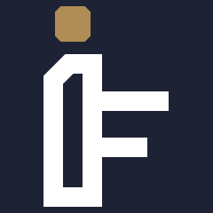 |  |

El concepto es el mismo en las dos: la chimenea de la Fundidora es el fuste de la F, las vigas son los brazos y la chispa oro es el token, que ocupa el lugar de la corona de NL.
**Riesgo de A:** la chispa sobre el fuste parece el punto de una "i", y se puede leer **"iF"**. **B** mueve la chispa a la viga superior, como si saliera de la chimenea.
**Recomendación: B.**

## 2. Logos

| Horizontal | Vertical |
| --- | --- |
| 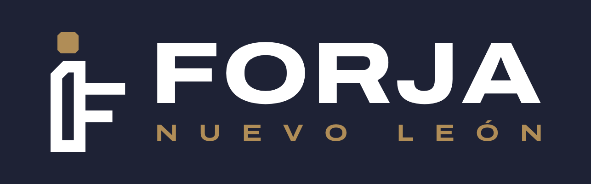 | 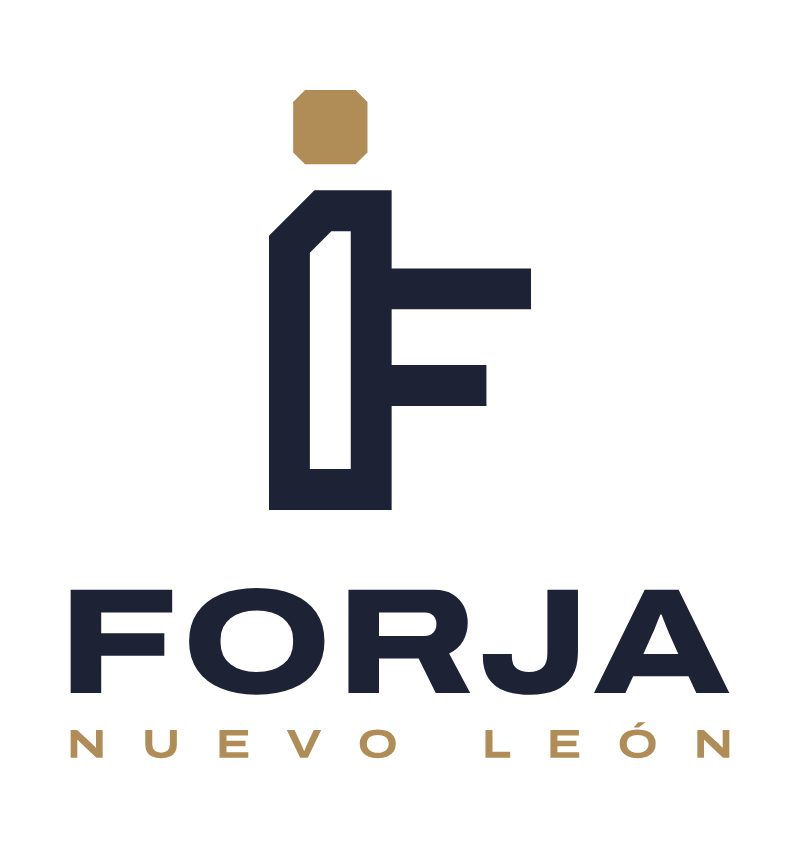 |

## 3. Íconos

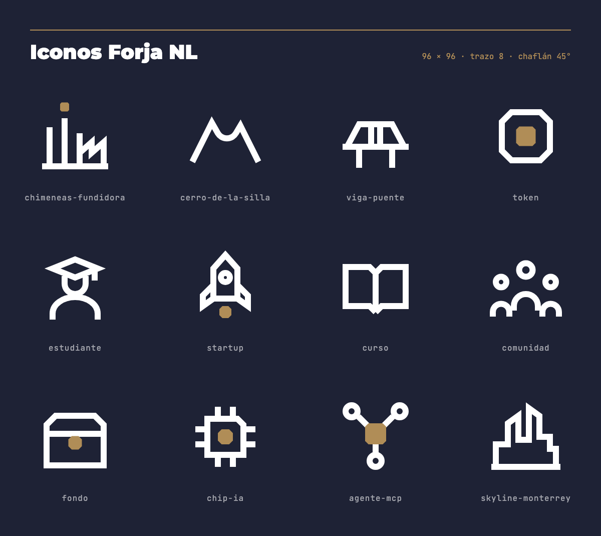

## 4. Storyboard del video de intro (7 frames, uno por bloque del speech)

Detalle de cada escena, transiciones y movimiento: [`storyboard/storyboard.md`](storyboard/storyboard.md)

| | |
| --- | --- |
| 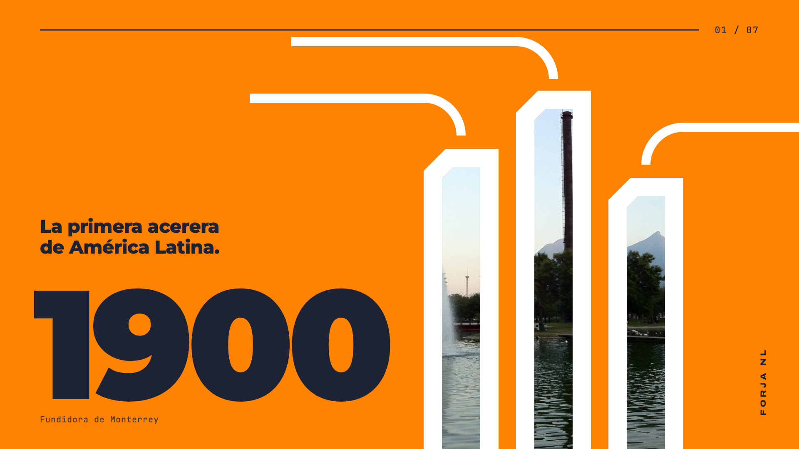 **1 · Fundidora, 1900** | 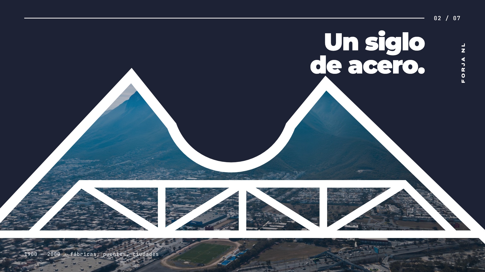 **2 · Un siglo de acero** |
| 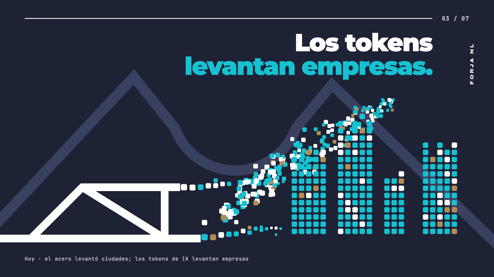 **3 · Los tokens levantan empresas** | 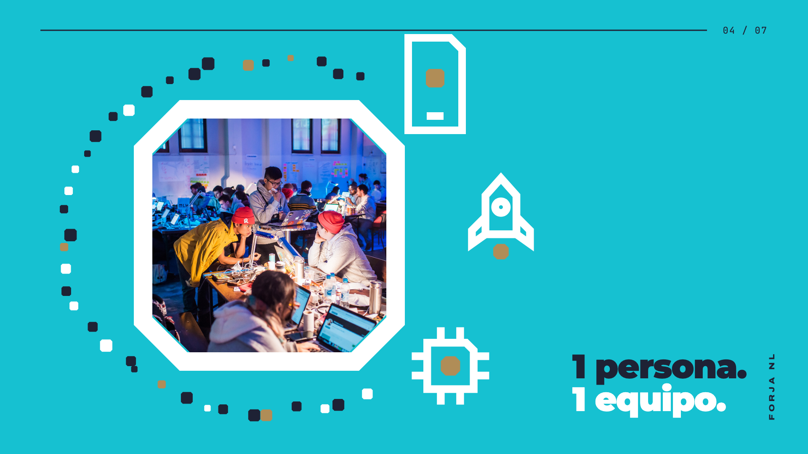 **4 · Una persona, un equipo** |
| 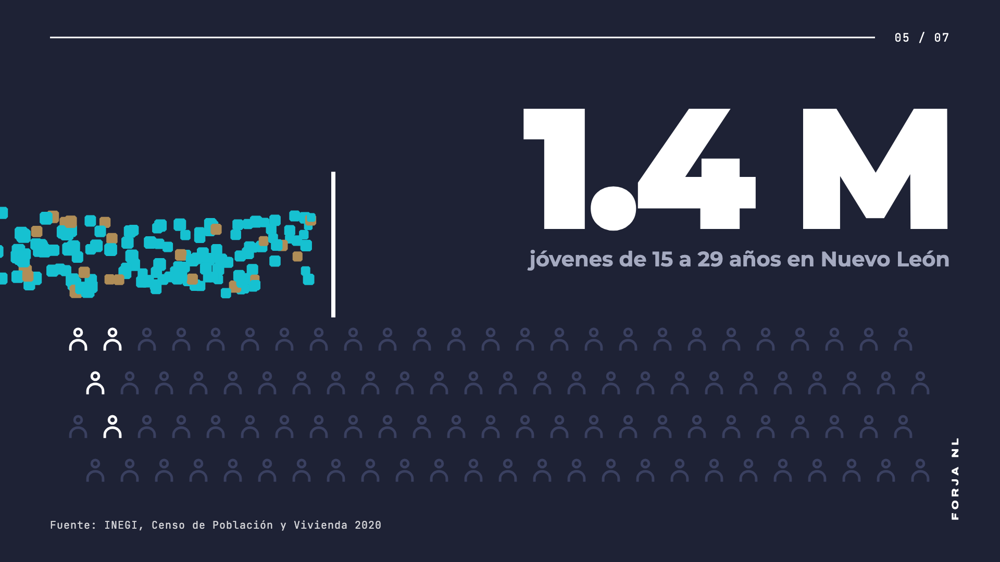 **5 · 1.4 M jóvenes sin acceso** | 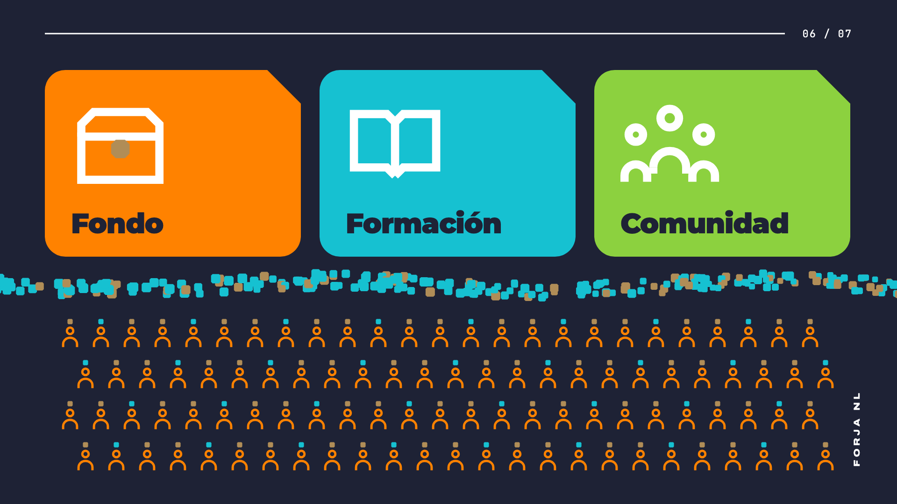 **6 · Forja NL: fondo, formación, comunidad** |
| 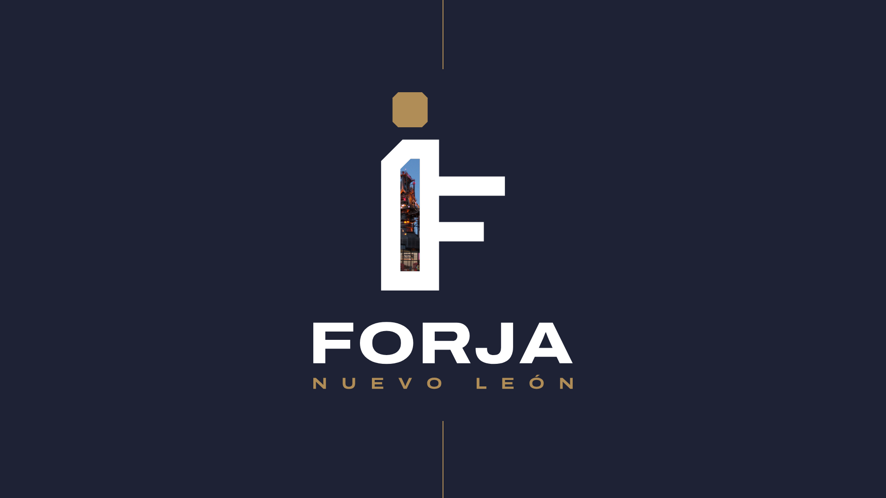 **7 · Cierre: logo** | |

## Pendientes conocidos
- **Frame 6** está saturado. En el motion entraría por capas: primero las tarjetas, luego el flujo y al final las figuras.
- **Foto de estudiantes (frame 4):** es de un hackathon en Helsinki. Si alguien tiene una foto propia de estudiantes en NL, es mejor.
- **Créditos de fotos:** son CC BY / BY-SA (ver [`referencias/fotos/CREDITOS.md`](referencias/fotos/CREDITOS.md)) y el video necesita una lámina de créditos al final.
- **Sitio web:** este PR ya trae el logo y los íconos nuevos. Vercel genera un preview del PR para revisarlo en vivo.

## Checklist para aprobar
- [ ] Símbolo: A o B
- [ ] Paleta y tipografía
- [ ] Storyboard: ¿alguna escena que cambiar?
- [ ] Sitio con la marca nueva (preview de Vercel)
